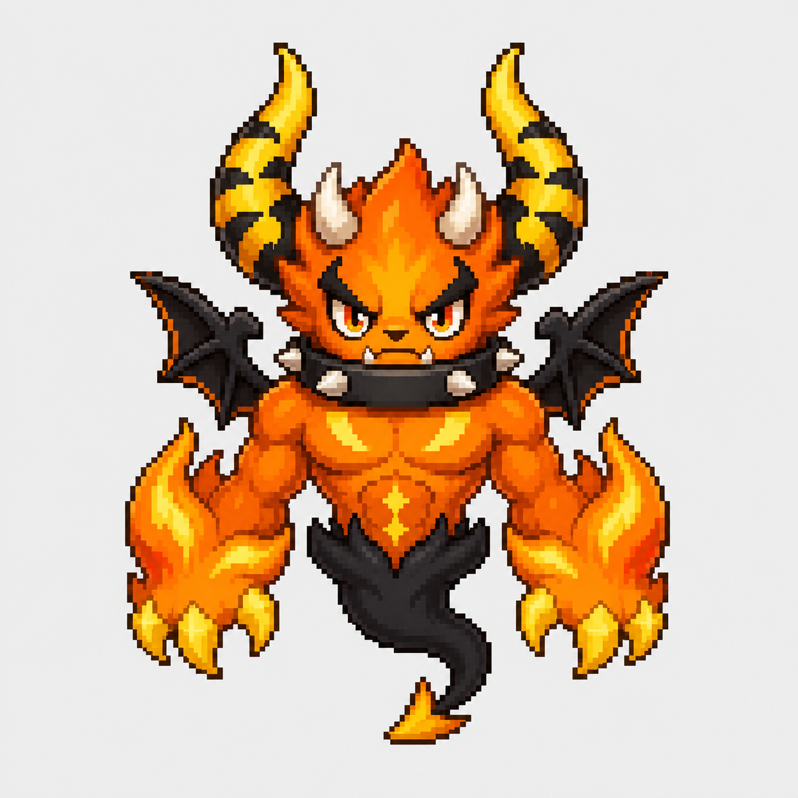

# Huoshen Codex Pet

Huoshen（火神）is an irritable but reliable pixel-art fire demon companion for Codex.

See [the character and animation brief](pet-brief.md) for the approved visual specification.

## Reference



## Character

- Style: Pixel art
- Personality: Irritable, energetic and focused
- Main colors: Orange, yellow and charcoal black
- Features:
  - Large yellow-and-black striped horns
  - Small forehead horns
  - Black bat wings
  - Spiked collar
  - Flame-shaped claws
  - Smoky lower body and pointed tail

## Animation states

- idle
- running-right
- running-left
- waving
- jumping
- failed
- waiting
- running
- review

## Asset checks and preview

`animation-map.json` is a tool-specific map, not a Codex host schema. Its nine row mappings and timing are checked against the locally inspected desktop build; that does not validate the artwork or other versions. The final two rows are retained for direction inspection, not task animations. Looping depends on the host context.

From the repository root, create a Python 3.9+ local environment and install the development dependency:

```sh
python3 -m venv .venv
. .venv/bin/activate
python -m pip install Pillow
python tools/validate_assets.py
python -m unittest discover -s tests
python -m http.server 8000
```

The current atlas produces one validation error: idle row 0, column 6 is nonempty even though the inspected host uses only columns 0–5. The validator exits nonzero until the asset or verified protocol changes; it does not modify the atlas.

Open <http://localhost:8000/tools/preview.html>. The preview uses adjustable demonstration timing, not verified host timing. It does not integrate with Codex or prove that host events and animation behavior work. See [the validation report](docs/validation-report.md) for evidence and remaining checks.
